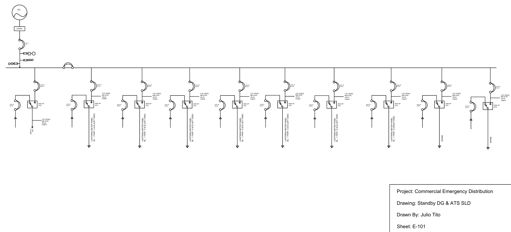

# Commercial Facility Standby Generator & ATS Power Distribution SLD

## Overview
AutoCAD single-line diagram (SLD) engineered to represent an industrial standby power distribution network for a multi-tenant commercial facility. The design models standby diesel generation, primary protection, dual-source automatic transfer switching (ATS), and dedicated branch feeder distribution for emergency lighting, life-safety loads, and utility panels.

## System & Design Specifications
- **Emergency Power Source:** 3-Phase Standby Diesel Generator (DG Set) with integrated governor and field control unit
- **Main Service Protection:** 400A, 4-Pole Air Circuit Breaker (ACB) / Bus Coupler with integrated thermal-magnetic overload protection
- **Metering & Telemetry Array:** 
  - Current Transformers (CT) with phase-selective Ampere meters
  - Voltmeter (V) and frequency monitoring
  - R-Y-B visual phase indication lamps
- **Transfer Switching Topology:** 
  - Dual-source Automatic Transfer Switches (ATS) rated 200A / 250A, 4-Pole
  - Dedicated Normal (Utility) vs. Emergency (Generator) interlocks
- **Distribution Feeder Network:**
  - Multiple dedicated branches feeding tenant/common-area Lighting Meter Panels
  - Essential facility life-safety circuits
  - Designated spare feeder capacity for future facility expansion
- **Conductor Specification:** 3.5-Core XLPE Insulated, Armored Aluminum Power Feeder Cables

## Drawing Standards
- **Drawing Sheet:** E-101
- **Standard Scale:** N.T.S. (Not to Scale schematic)
- **Drafting Software:** Autodesk AutoCAD
- **Deliverables:** Native `.dwg` CAD drawing file and vector `.pdf` release sheet located in the `drawings/` directory.
